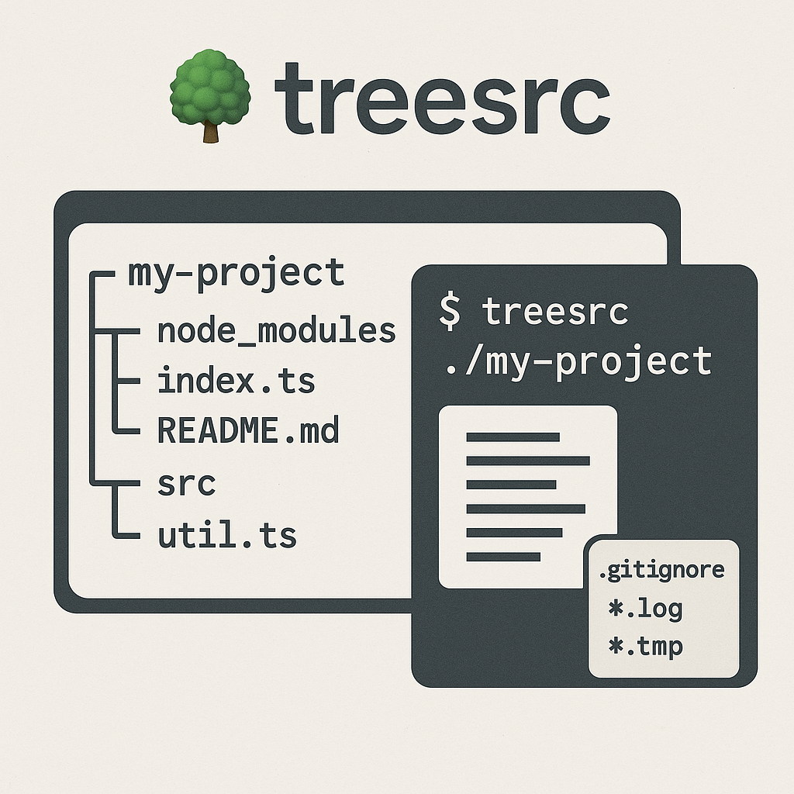

> A CLI tool written in [Almide](https://github.com/almide/almide) that displays directory structures and file contents, fully respecting `.gitignore` rules. It works on any kind of file: it never parses the code it prints.

## 📦 Installation

```bash
almide install github.com/O6lvl4/treesrc   # one native binary → ~/.local/bin/treesrc
```

The npm package (`npm install -g treesrc`) still serves the last TypeScript release, v1.0.3.

## 🚀 Quick Usage

Simply run `treesrc` followed by the target directory:

```bash
treesrc ./my-project
```

You can also specify additional ignore patterns:

```bash
treesrc ./my-project -i '*.log' '*.tmp'
```

## 🎯 Features

- Display directory structures as a neatly formatted tree
- View the contents of each file in the directory, with line numbers
- Respects `.gitignore` rules, including `.gitignore` files in subdirectories, `!` negation, `**` and `[...]` classes
- Supports custom ignore patterns via CLI arguments
- Skips binary files (a NUL byte in the first 8000 bytes, as git decides) and files that are not valid UTF-8
- Lists a symlinked directory without following it

## 🛠️ CLI Options

```bash
Usage: treesrc <directory> [options]

Arguments:
  directory                   Target directory

Options:
  -i, --ignore <patterns...>  Additional ignore patterns
  -V, --version               output the version number
  -h, --help                  display help for command
```

## ⚙️ Development

```bash
git clone https://github.com/O6lvl4/treesrc.git
cd treesrc
almide test                 # unit tests (the .gitignore matcher, argument parsing, drawing)
almide build                # → ./treesrc
python3 ci/smoke.py         # runs the binary on a sample tree and compares the whole output
```

- `src/gitignore.almd` — the `.gitignore` pattern matcher, pure and self-contained
- `src/main.almd` — arguments, the directory walk and the output

## 📝 Changelog

### v2.0.0

- **Rewritten in Almide**; no runtime dependencies, one native binary
- `.gitignore` files in subdirectories now apply to their own directory
- The last visible entry of a directory is always drawn with `└──`, even when ignored entries follow it
- A file that is not valid UTF-8 is skipped with "File encoding unreadable. Skipped." instead of printed with replacement characters
- A missing directory is an error message and exit code 1

### v1.0.3

- **Improved binary file detection accuracy**
  - Integrated `isbinaryfile` library for reliable binary detection.
  - Added extra check to detect corrupted or binary-like text files based on control character frequency.
  - Files with unreadable UTF-8 encoding are now automatically skipped.

### v1.0.2

- **Added binary file detection**  
  Files are now checked for binary content by scanning the first bytes. If binary data is detected, the file content display is skipped with a message: "Binary file not displayed."

- **Updated documentation**  
  README updated to reflect changes regarding handling of binary files.

### v1.0.1
- Added `.git` to default ignore patterns
- Improved documentation

### v1.0.0
- First stable release
- Rewritten in TypeScript
- npm published

## 📄 License

[MIT License](LICENSE)

---

Made with ❤️ by [O6lvl4](https://github.com/O6lvl4).
